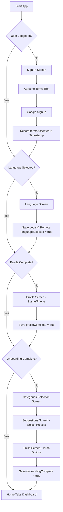

# Repeato - Comprehensive Project Documentation

Repeato is a cross-platform (iOS, Android, and Web) mobile application built using **React Native**, **Expo**, and **TypeScript**. It is designed to simplify personal routine organization and household chore coordination through repeating tasks, calendar-based progress, statistics tracking, and realtime household collaboration.

---

## 1. Introduction & Overview

Repeato helps individuals and shared households manage recurring responsibilities (chores, finance bills, health checks, etc.) in a collaborative, gamified, and offline-resilient manner.

### Core Technology Stack
- **Framework:** React Native + Expo (managed workflow)
- **Router:** Expo Router (file-based navigation stack)
- **UI Library:** React Native Paper (Material Design) + Vanilla CSS/StyleSheets
- **Database & Sync:** Google Firebase (Authentication & Firestore cloud database)
- **Local Storage:** AsyncStorage (for offline cache, language, and user profile)
- **QR Codes:** `react-native-qrcode-svg` (for native and web rendering)

---

## 2. Objective & Scope

### Project Objective
The primary objective of Repeato is to solve chore coordination and task tracking. It achieves this by providing:
1. **Accountability:** Household stats showing on-time completion rates for each member.
2. **Realtime Sync:** Realtime Firestore document replication for household tasks and profiles.
3. **Usability:** A natural language parser that converts input like *"Rent bills every month ₹10000"* into structured task intervals, categories, and finance details.
4. **Resiliency:** Local storage fallbacks and an offline synchronization queue that resolves queued operations when connections are restored.

### App Scope
- **User Authentication:** Google Sign-in with native and web redirect configurations.
- **Onboarding Workflow:** Step-by-step wizard capturing language preferences, user profile completions, category configurations, preset suggestions, and push notification settings.
- **Task Management:** Creating, editing, complete, skip, snooze, pin, duplicate, archive, and delete operations.
- **Household Management:** Bidirectional household joining via code or QR scanning, list of shared tasks, activity logs, member removal confirmations, and realtime task unsharing or deletion.
- **Analytics & Gamification:** A weekly visual checklist tracker, completion streaks, and a contribution leaderboard sorted by member on-time percentages.

---

## 3. Future Scope & Roadmap

- **Advanced Notification Triggering:** Expand notifications for web triggers and support rich customizable action buttons (e.g., *Complete*, *Snooze 2 Days*) across web browsers.
- **Multi-Household Support:** Allow users to create or join multiple distinct households (e.g. *Home*, *Office*, *Vacation Cabin*) and easily toggle contexts.
- **Machine Learning Recommendations:** Leverage local user historical completion patterns to recommend chore timings, optimize snoozes, and predict upcoming overdue bottlenecks.
- **Financial Categorization Extensions:** Build complex ledger accounts tracking household chore balances (e.g. when a chore is completed, credit/debit balances adjust between household members).

---

## 4. Architecture & Navigation Layout

The application directory structure is mapped as follows:

```
f:/DEV/repeato/
├── app/                      # Expo Router File-Based Routing
│   ├── (onboarding)/         # Login, Language, Profile, and Categories Wizard
│   ├── (tabs)/               # Bottom Tabs (Dashboard, Household, Insights, Profile)
│   ├── _layout.tsx           # Global Navigation Guard & App Providers wrapper
│   ├── presets.tsx           # Preset Library Screen Modal
│   ├── privacy.tsx           # Friendly Privacy Policy Screen
│   ├── terms.tsx             # Friendly Terms of Service Screen
│   └── index.tsx             # Root Redirect Dispatcher
├── src/
│   ├── components/           # Reusable UI Elements (TaskCard, ScreenShell, Sheets, etc.)
│   ├── constants/            # Styling Colors, Radius, Typography, and Categories Map
│   ├── data/                 # Repositories & Local/Remote Data Sources
│   ├── domain/               # Domain Models (Task Parsing, Recurrence logic, Insights stats)
│   ├── hooks/                # Custom React Hooks (Task Parser, Search/Filter states)
│   ├── i18n/                 # Localization translations (English & Hindi)
│   ├── providers/            # Context Providers (Auth, Tasks, Toast, Notifications)
│   ├── services/             # Firebase App, Auth, Firestore, and Notification Services
│   └── types/                # TypeScript Interfaces
```

---

## 5. Detailed Module Flows & Functionality

### A. Authentication & Onboarding Flow


1. **Sign-In & Checkout:**
   - [sign-in.tsx](file:///f:/DEV/repeato/app/(onboarding)/sign-in.tsx) enforces checking a friendly Terms checkbox before logging in.
   - The timestamp is stored inside `user.termsAcceptedAt` on Firestore.
2. **Navigation Guard:**
   - [app/_layout.tsx](file:///f:/DEV/repeato/app/_layout.tsx) continuously checks the loaded user's state. It locks incomplete accounts to onboarding screens and redirects completed users away from onboarding back to `/(tabs)`.

---

### B. Tasks & Recurrence Engine
- **Task Parsing:** [parseTaskInput](file:///f:/DEV/repeato/src/domain/parser.ts) processes natural language strings using Regex. It parses amounts (e.g. `₹5000`), categories (e.g. `rent`, `health`), and recurrence intervals (e.g. `every 3 months`, `monthly on the 10th`).
- **Recurrence Logic:** [recurrence.ts](file:///f:/DEV/repeato/src/domain/recurrence.ts) computes the next due date based on the interval:
  - **Daily:** `dueDate = today + intervalDays`
  - **Weekly:** Computes due date on the target weekday (e.g. every Sunday).
  - **Monthly (Day of Month):** Computes due date on the specific numerical day (e.g. 10th of every month).
  - **Nth Weekday:** Computes due date on a specific week day index (e.g. 2nd Wednesday of every month).

---

### C. Household Synchronization & Realtime Member Removal
- **Invitation Sync:** Inputting a code resolves B's invitation profile from `householdInvites` and writes A and B mutually to each other's `householdMembers` collection in Firestore.
- **Member Removal Flow:**
  ```mermaid
  sequenceDiagram
      User A->H>User A: Taps member remove button
      User A->>User A: Double confirm Alerts (Remove, Task Cleanup options)
      User A->>Firestore (B's Profile): Removes User A, sets removedBy = "User A"
      User A->>Firestore (A's Profile): Removes User B from householdMembers
      User A->>Firestore (B's Tasks): Deletes/Unshares A's shared tasks
      Firestore (B's Profile)-->>User B: onSnapshot profile listener fires
      User B->>User B: Shows alert: "Removed by User A"
      User B->>Firestore (B's Tasks): unshareAllLocalTasks updates B's own tasks
  ```

---

## 6. Codebase Security & Storage Policies

1. **Personalized Ads & Task Customization:**
   - Task completion logs, scheduling categories, and timelines are processed to generate custom in-app suggestions and task recommendation impressions.
2. **Zero-Selling Privacy Policy:**
   - Explicitly guarantees that personal identities, email addresses, and task schedule details are **never** traded, sold, or shared with third-party networks.
3. **Firestore Security Principles:**
   - Realtime snapshots (`onSnapshot`) listen on `/users/{uid}` and `/users/{uid}/tasks`. Writing permissions (`saveOther`) are authorized for matched household contacts.
